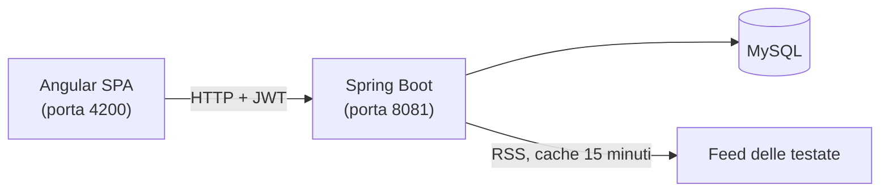
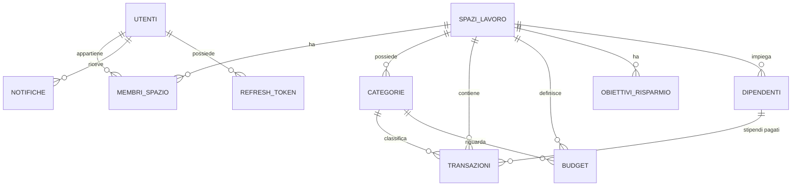

# Personal Finance — Full Stack Financial Management Platform

Piattaforma web per gestire le **finanze personali e aziendali**: transazioni, budget con avvisi, obiettivi di risparmio, dashboard con grafici, spazi di lavoro condivisi con ruoli, stipendi dei dipendenti e resoconto mensile in PDF. In più, una home pubblica con le **notizie di economia internazionale**.

Progetto realizzato come portfolio: backend **Spring Boot**, frontend **Angular**, database **MySQL**, con attenzione a sicurezza, test e a una struttura facile da leggere e da estendere.

## Anteprima

| | |
|---|---|
|  |  |
| Home pubblica con le notizie di economia internazionale | Dashboard con schede di riepilogo e grafici |
|  |  |
| Transazioni con filtri, ordinamento e paginazione | Budget mensili con stato e soglie |
|  |  |
| Dipendenti e stipendi di uno spazio aziendale | Documentazione interattiva delle API |

<p align="center"></p>

## Funzionalità

**Per tutti gli utenti**
- Registrazione, accesso, modifica del profilo e della password, eliminazione dell'account.
- **Transazioni** di entrata e uscita, con ricerca testuale, filtri (date, categoria, tipo, metodo di pagamento, importo), ordinamento e paginazione.
- **Categorie** predefinite e personalizzate.
- **Budget mensili** per categoria: il calcolo di speso, disponibile, percentuale e stato (nei limiti, attenzione dall'80%, superato dal 100%) è fatto dal backend; al superamento delle soglie arriva una notifica.
- **Obiettivi di risparmio** con barra di avanzamento, versamenti e scadenza.
- **Dashboard** con saldo, entrate, uscite e risparmio del mese, budget utilizzato, obiettivi, ultime transazioni e categorie con più spese.
- **Grafici** alimentati dalle API: entrate e uscite per settimana o mese, andamento del saldo, spese per categoria, utilizzo dei budget.
- **Notifiche** nell'applicazione, con contatore non lette.
- **Resoconto mensile in PDF** (entrate, uscite, categorie, budget, stipendi, elenco delle transazioni).
- **Notizie** di economia internazionale dai feed pubblici delle principali testate.

**Spazi aziendali e team**
- Ogni utente ha uno **spazio personale** e può creare **spazi aziendali** condivisi.
- Ruoli nello spazio: proprietario, amministratore, membro, lettore (tabella sotto).
- **Dipendenti e stipendi:** anagrafica, attivazione e disattivazione, registrazione dello stipendio mensile (diventa una transazione di uscita), storico dei pagamenti. I singoli stipendi sono visibili solo a chi gestisce lo spazio.

**Amministrazione della piattaforma**
- Elenco e ricerca degli utenti, blocco e sblocco (con revoca immediata delle sessioni).
- Gestione delle categorie globali e statistiche generali (solo conteggi: gli amministratori non vedono i dati finanziari degli utenti).

### Permessi negli spazi

| Operazione | Proprietario | Amministratore | Membro | Lettore |
|---|:---:|:---:|:---:|:---:|
| Consultare dati, dashboard, budget, obiettivi | ✅ | ✅ | ✅ | ✅ |
| Inserire transazioni | ✅ | ✅ | ✅ | ❌ |
| Modificare o eliminare transazioni | tutte | tutte | solo le proprie | ❌ |
| Categorie, budget, obiettivi | ✅ | ✅ | ❌ | ❌ |
| Dipendenti, stipendi, PDF del resoconto | ✅ | ✅ | ❌ | ❌ |
| Aggiungere e rimuovere membri | ✅ | membri e lettori | ❌ | ❌ |
| Cambiare i ruoli, nominare amministratori | ✅ | ❌ | ❌ | ❌ |
| Eliminare lo spazio | ✅ | ❌ | ❌ | ❌ |

## Tecnologie

| Area | Tecnologie |
|---|---|
| Backend | Java 21, Spring Boot 3.5, Spring Web, Spring Data JPA / Hibernate, Spring Security, JWT (jjwt), Bean Validation, Flyway, Lombok, OpenPDF, springdoc (OpenAPI / Swagger UI), Maven |
| Frontend | Angular 19 (componenti standalone, signal, Reactive Forms, Router, guard e interceptor HTTP), TypeScript, Bootstrap 5, Chart.js (ng2-charts) |
| Database | MySQL (produzione e sviluppo), H2 in memoria (test) |
| Test | JUnit 5, AssertJ, Spring Boot Test / MockMvc, Karma e Jasmine |

## Architettura



**Backend:** monolite modulare a livelli.

```
controller  ->  service (interfacce + implementazioni)  ->  repository  ->  database
    |               |
   DTO           mapper
```

- `controller`: gestiscono solo HTTP (richiesta, validazione, codice di risposta).
- `service`: contengono tutta la logica e i controlli sui permessi.
- `repository`: accesso ai dati con Spring Data JPA.
- `dto` / `mapper`: le entità JPA non escono mai dalle API.
- `security`: filtro JWT, gestione degli errori 401/403.
- `exception`: gestione globale degli errori in un formato unico.

**Frontend:** `core` (sessione, interceptor, guard, layout), `shared` (componenti e utilità riusabili), `features` (una cartella per pagina), `models` (le interfacce dei dati).

**Modello dei dati:** tutti i dati finanziari appartengono a uno **spazio di lavoro**, non a un utente; l'utente vi accede con un ruolo.



Lo schema è creato e versionato con **Flyway** (`back-end/src/main/resources/db/migration`), che inserisce anche le categorie predefinite.

### Perché questa scelta

| Scelta | Motivazione |
|---|---|
| Monolite modulare, non microservizi | Un solo deploy e meno complessità: l'applicazione non ha bisogno di scalare parti separate |
| Dati legati a uno *spazio di lavoro* | Permette di usare lo stesso modello per uso personale e aziendale, con team e ruoli, senza duplicare funzioni |
| Controllo dei permessi nei service | Le regole valgono per qualunque punto di ingresso e si provano con test senza HTTP |
| 404 a chi non è membro di uno spazio | Non si rivela nemmeno l'esistenza dei dati altrui; 403 solo a chi è membro ma non ha il ruolo |
| DTO e mapper manuali | Le entità non escono dalle API e il passaggio dei dati si legge a colpo d'occhio |
| Calcoli (budget, saldo, trend) nel backend | Il frontend non può essere l'ultimo livello di controllo e i valori sono gli stessi per ogni client |
| JWT breve (15 min) + refresh token a rotazione, salvato come hash | Limita i danni di un token rubato; il refresh si usa una volta sola e nel database non ci sono token utilizzabili |
| Ruolo e stato dell'utente riletti a ogni richiesta | Un utente bloccato perde subito l'accesso |
| Flyway | Schema versionato e riproducibile; Hibernate si limita a validarlo |
| MySQL con H2 nei test | Test veloci, senza database da installare |
| Notizie lette dal backend con cache | I browser non possono leggere i feed (CORS) e così le testate non sono interrogate a ogni visita |
| Angular standalone con signal | Stile attuale della piattaforma, meno codice di supporto |
| Bootstrap senza il suo JavaScript | Menu e finestre si gestiscono con lo stato di Angular, più semplice da collaudare |
| Documentazione API centralizzata | Gli endpoint si documentano in un solo file; un test impedisce di dimenticarne uno |

## Struttura del progetto

```
personal-finance/
├── back-end/                 API REST (Spring Boot, Maven)
│   ├── src/main/java/...     controller, service, repository, entity, dto, mapper, security, config, exception
│   ├── src/main/resources/   application*.properties e migrazioni Flyway (db/migration)
│   ├── src/test/             test (H2 in memoria)
│   └── .env.example          elenco delle variabili d'ambiente
├── front-end/                applicazione Angular
│   └── src/app/              core, shared, features, models
├── docs/
│   ├── carica-dati-demo.py   script che crea l'account demo con dati di esempio
│   └── screenshots/          immagini usate in questo README
├── LICENSE
└── README.md
```

## Requisiti

- **JDK 21** o superiore
- **Node.js 22** e Angular CLI 19: `npm install -g @angular/cli@19`
- **MySQL 8** o superiore (provato con la 9.5)
- Maven non serve installarlo: nel progetto c'è il wrapper `./mvnw`
- Facoltativo: Python 3 per lo script dei dati demo; Google Chrome per i test del frontend

## Avvio in locale

### 1. Database
Crea il database vuoto (le tabelle e le categorie predefinite le crea Flyway al primo avvio):

```sql
CREATE DATABASE personal_finance CHARACTER SET utf8mb4 COLLATE utf8mb4_unicode_ci;
```

### 2. Backend
Dalla cartella `back-end`:

```bash
export DB_PASSWORD='la_password_di_mysql'
export SERVER_PORT=8081
export JWT_SECRET=$(openssl rand -base64 48)

# Facoltativo: crea all'avvio l'account amministratore (se non ne esiste già uno)
export ADMIN_USERNAME=admin
export ADMIN_EMAIL=admin@example.com
export ADMIN_PASSWORD='scegli-una-password-sicura-1'

./mvnw spring-boot:run
```

Il frontend si aspetta il backend sulla porta **8081**; per cambiarla modifica `front-end/src/environments/environment.development.ts`.

### 3. Frontend
Dalla cartella `front-end`:

```bash
npm install
ng serve
```

Apri **http://localhost:4200**.

### Variabili d'ambiente del backend

| Variabile | Obbligatoria | Significato |
|---|:---:|---|
| `JWT_SECRET` | sì | Segreto per firmare i token, almeno 32 caratteri. Se manca o è corto l'app non parte |
| `DB_PASSWORD` | sì (se MySQL ha una password) | Password dell'utente del database |
| `DB_URL` | no | Predefinito: `jdbc:mysql://localhost:3306/personal_finance?serverTimezone=UTC` |
| `DB_USERNAME` | no | Predefinito: `root` |
| `SERVER_PORT` | no | Porta del backend (predefinita 8080; il frontend usa la 8081) |
| `SPRING_PROFILES_ACTIVE` | no | `dev` (predefinito) o `prod` |
| `ADMIN_USERNAME`, `ADMIN_EMAIL`, `ADMIN_PASSWORD` | no | Creano l'amministratore iniziale se non esiste già |

I segreti si passano solo da variabili d'ambiente: nel repository non ci sono password. Nel profilo `prod` non esistono valori predefiniti per il database.

## Account demo

Con il backend acceso (e un database vuoto) esegui, dalla cartella radice del progetto:

```bash
python3 docs/carica-dati-demo.py
```

Lo script crea l'utente **`demo`** con password **`Demo12345`** e carica:
- nello **spazio personale**: 6 mesi di entrate e uscite, tre budget del mese corrente e due obiettivi di risparmio;
- nello **spazio aziendale "Acme S.r.l."**: ricavi e costi, due budget, due dipendenti e gli stipendi pagati (nel mese corrente uno risulta ancora da pagare).

Accedi su http://localhost:4200 con quell'utente; gli spazi si cambiano dal selettore in alto a sinistra. L'account **amministratore** esiste solo se hai impostato le variabili `ADMIN_*`.

## Documentazione delle API

Con il backend acceso (profilo `dev`) la documentazione interattiva è su:

- **Swagger UI:** http://localhost:8081/swagger-ui.html
- **OpenAPI (JSON):** http://localhost:8081/v3/api-docs

Per provare gli endpoint protetti: esegui `POST /api/auth/login`, copia `accessToken`, premi **Authorize** e incollalo (senza scrivere "Bearer"). Ogni endpoint indica chi può usarlo e i codici di risposta possibili; gli errori hanno sempre la stessa struttura (`timestamp`, `status`, `errore`, `messaggio`, `percorso` e, per la validazione, `campi`). In produzione Swagger è disattivato.

## Test

```bash
# Backend: oltre 180 test, senza bisogno di MySQL (usano H2)
cd back-end
./mvnw test

# Frontend: circa 60 test (serve Google Chrome)
cd front-end
ng test --watch=false --browsers=ChromeHeadless
```

I test del backend coprono i service, i repository, i controller con richieste HTTP simulate, la generazione del PDF, la lettura dei feed e, in particolare, **sicurezza e permessi**: autenticazione, ruoli, isolamento tra spazi (non si toccano dati altrui cambiando l'id nella richiesta), blocco degli utenti e rinnovo dei token. Quelli del frontend verificano servizi, interceptor, guard, utilità e componenti principali.

## Sicurezza in sintesi

- Password cifrate con **BCrypt**; criteri minimi di robustezza validati nel browser e nel backend.
- **JWT** di accesso breve e refresh token monouso, salvato nel database solo come hash; il segreto arriva solo da variabile d'ambiente.
- Login con lo stesso messaggio per utente inesistente e password errata, e tempi di risposta uniformi.
- Controllo di appartenenza e ruolo su ogni risorsa; le query filtrano sempre per spazio.
- Azioni sensibili (cambio password, eliminazione account) richiedono la password attuale.
- CORS limitato al frontend, validazione degli input, gestione globale degli errori senza dettagli interni.
- Lettore dei feed protetto da attacchi XXE e link filtrati ai soli indirizzi web.
- Swagger spento in produzione.
- Limite noto: nel browser il refresh token è in `localStorage` (l'access token resta solo in memoria); un'alternativa più robusta sono i cookie `HttpOnly`.

## Sviluppi futuri

- **Docker e Docker Compose** per avviare tutto con un solo comando.
- **Git e GitHub** con **CI/CD** (esecuzione automatica dei test) e successivo **deploy sul cloud**.
- **Esportazione dei dati in CSV** (oggi è disponibile il PDF mensile) e importazione da estratto conto.
- **Transazioni ricorrenti** (affitto, abbonamenti) generate in automatico.
- Recupero della password via email, limite ai tentativi di accesso, conferma dell'email, autenticazione a due fattori.
- Trasferimento della proprietà di uno spazio, allegati alle spese, registro delle attività.
- **Foglio di stile globale** con i colori in un solo file e **tema scuro**.

## Note sulle notizie

Le notizie sono titoli, brevi estratti e immagini di anteprima dei feed RSS pubblici delle testate indicate (BBC News, The Guardian, CNBC, MarketWatch, ANSA). Ogni articolo rimanda al sito originale, a cui appartengono i contenuti: prima di un uso diverso da quello dimostrativo controllare i termini di ciascuna testata.

## Autore

**Daniele Schiavoni** — junior developer Java / Spring Boot / Angular.
GitHub: [daniele_schiavoni](https://github.com/daniele_schiavoni)

## Licenza

Vedi il file [LICENSE](LICENSE).
